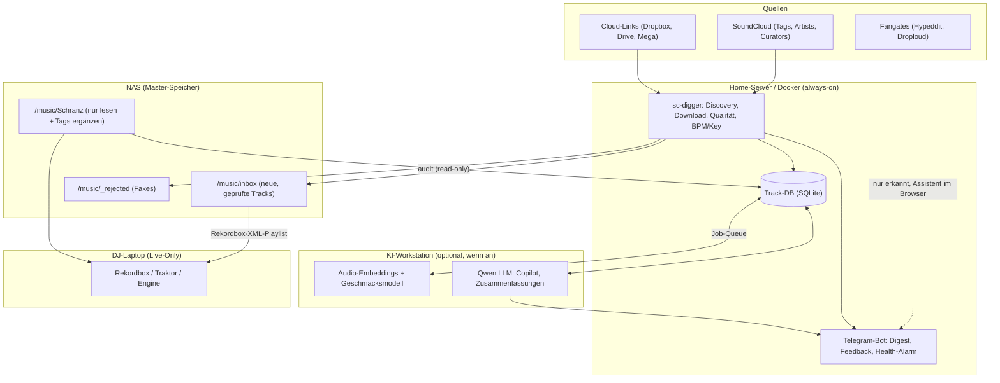

# 🚀 sc-digger – Master-Roadmap & Architektur

Dieses Dokument beschreibt die Gesamtarchitektur und Entwicklungs-Roadmap für das `sc-digger`-Ökosystem.
Ziel ist eine lückenlose, professionelle Pipeline: von der SoundCloud-Suche über Qualitätsprüfung
bis zur fertigen Bereitstellung auf dem DJ-Laptop – ohne die bestehende Sammlung oder die
Rekordbox-Bibliothek zu gefährden.

---

## 🧱 Leitprinzipien

1. **Die Master-Sammlung wird nie destruktiv verändert.** Keine Verschiebungen, Umbenennungen oder
   Audio-Eingriffe im Archiv. Rekordbox/Traktor verknüpfen Cues, Hot Cues und Playlists über den
   Dateipfad – ein verschobener Track verliert sie. Tags werden im Archiv nur ergänzt, nie überschrieben.
2. **Messen statt Verändern.** Lautheit, BPM, Key werden gemessen und als Metadaten gespeichert.
   Auto-Gain der DJ-Software übernimmt den Pegelausgleich.
3. **Fair zu den Artists.** Gates werden erkannt und assistiert, aber nicht umgangen. Öffentlich
   verlinkte Downloads (Cloud-Links, native Downloads) werden automatisch geladen.
4. **Laut scheitern.** Die inoffizielle SoundCloud-API wird irgendwann brechen. Ausfälle müssen
   als Alarm ankommen, nicht als stiller leerer Digest.
5. **Audio vor Text.** Stil- und Geschmacksurteile basieren auf Audio-Embeddings. Das LLM ist
   Dialog- und Zusammenfassungsschicht, nicht das Ohr.

---

## 🏛️ System-Architektur & Rollenverteilung

* **Home-Server (Docker, Cron):** Läuft durchgehend. Discovery, Downloads, Qualitätscheck und
  librosa-Analyse sind leicht genug für den Server. Ein Ausfall der Workstation stoppt den
  täglichen Lauf nicht.
* **KI-Workstation:** Rechenintensives (Embeddings, Qwen) läuft als asynchroner Nachlauf über eine
  Job-Tabelle in der Track-DB, sobald die Workstation an ist. Alles funktioniert auch ohne sie.
* **NAS:** Master-Sammlung (read-mostly) und Inbox.
* **DJ-Laptop:** Keine Hintergrunddienste; neue Tracks kommen als Rekordbox-Playlist an.

---

## 🧭 Entwicklungsphasen im Überblick

| Phase | Fokus | Status | Kernfeatures |
|---|---|---|---|
| **Phase 1** | Basis & DJ-Ready Pipeline | ✅ **Abgeschlossen** | Native Downloads, FFT-Fake-Check, BPM/Key, Tagging, Inbox-Organize, Modi discover/playlist/similar |
| **Phase 1.5** | Robustheit | ✅ **Abgeschlossen** | BPM-Oktav-Korrektur, Health-Alarm |
| **Phase 2** | Track-DB & Library Audit | 🟡 **Fast fertig** | Zentrale DB ✅, `audit` ✅, Fingerprint-Duplikate ✅, LUFS-Tags ✅, Container-Healthcheck ✅, Inbox-Normalisierung ✅, robuste Discovery ✅, Retry-Queue ✅, Engagement-Tempo ✅, `/stats` ✅, Sonntags-Digest mit Grafik ✅ (#116, Standard aus); offen: nichts |
| **Phase 3** | Feedback & Smart Ingestion | 🟡 **Laufend** | 👍/👎 ✅, Cloud-Downloads ✅, DJ-Sets inkl. kurzer Mixe ✅, Rekordbox-Wochen-XML ✅, Curator-Mining 🟡 (Vorschläge ✅), Cloud-Quellen erweitern ✅, Kaufliste ✅, Eingangsordner ✅, Promo-Abzug und Sperrliste ✅, Tag-Rotation/Exploration ✅ (#135, #141), Artist-Reputation ✅ (#140), Live-Preview ✅ (Snippet #132, `/preview` #147, Stream-Preview #168, beide Schalter standardmäßig aus), Rekordbox-Komfort 🔵 (3.11), Status „übernommen“ ✅ (3.12) |
| **Phase 4** | Geschmacksmodell & KI-Copilot | 🔵 Geplant | Audio-Embeddings, persönlicher Taste-Score, Qwen-Copilot via Tool-Calling; begonnen: Trend-Radar (#122) |
| **Phase 5** | DJ-Performance & Set-Tools | 🔵 5.1–5.4 geplant, Rest 🟣 Vision | Harmonic Mixing per `/mix` ✅; Strukturanalyse, Auto-Cues, Drop-Preview, Breakdown-Anteil; später Embedding-Recommender, Web-Dashboard, Stem-Extraktion |

---

## ✅ Phase 1: DJ-Ready Discovery (Abgeschlossen)

- [x] **Drei Modi:** `discover` (Tags + gefolgte Artists), `playlist` (Playlist/Likes gegen Sammlung), `similar` (Related/Track-Radio).
- [x] **Perzentil-Scoring** relativ zur Genre-Baseline statt fixer Like-Ratio.
- [x] **Download-Klassifizierung:** native / Gate (Hypeddit, Droploud, Toneden, Artist Union) / Store / Cloud / nur Stream.
- [x] **Native Download & Quality Check:** `scdl`, ffprobe + FFT-Spektrum-Cutoff gegen Transcodes.
- [x] **BPM- und Camelot-Key-Erkennung** aus dem Audio (`librosa`, Krumhansl-Kessler).
- [x] **Auto-Tagging** (MP3, FLAC, AIFF, M4A) und **Inbox-Organize** nach `inbox/<BPM>/<Key>/`.
- [x] **Telegram-Digest**, gruppiert nach Download-Weg; State-DB gegen Doppelmeldungen; Export-Datei als Anhang.
- [x] **Telegram-Bot:** Playlist- oder Track-Link schicken → volle Liste bzw. Station mit Sammlungsabgleich.
- [x] **Referenz-Accounts:** Reposts/Likes von 28 Schranz-DJs/Labels mit Score-Bonus (Vorstufe zu Curator-Mining).
- [x] **Lautheits-/Clipping-Check** (EBU R128, LRA): Brickwall-Master landen in `_rejected/clipped/`.
- [x] **Nur Original-Downloads** (`--only-original`), mit `SOUNDCLOUD_AUTH_TOKEN` automatisch, sonst verlinkt.
- [x] **Harmonische Playlist (neu):** `_eval/dj_export.py` baut aus einem Ordner eine
      harmonisch sortierte **M3U8-Playlist** plus CSV und Report. Übergänge sind auf
      Camelot-Nachbarschaft und ΔBPM begrenzt; wo das nicht geht, wird sichtbar geschnitten
      statt unharmonisch gemischt. Abgesichert durch `tests/test_dj_workflow.py` (29 Tests).

> **Prüfbericht zur Analyse-Pipeline:** [REVIEW-2026-10-14.md](_eval/REVIEW-2026-10-14.md).
> Gemessen auf einem Ground-Truth-Korpus: BPM 0/29 → **29/29** exakt, Key 83 % → **100 %**;
> zusätzlich drei konkrete Fehler in der Qualitätsprüfung (`cutoff == 0` gilt als „ok",
> Fixed-Offset übersieht lange Intros, Lossless-Erkennung über Codec-Namen) sowie die
> Empfehlung, Analyse-, Tagging- und Playlist-Schritt auf dem Server nachzuziehen.

## ✅ Phase 1.5: Robustheit (Abgeschlossen)

- [x] **BPM-Oktav-Korrektur:** Onset-basierte Erkennung springt bei manchem Material auf halbes/doppeltes
  Tempo. Audio-BPM wird per ×2/÷2 ins konfigurierte Fenster geklemmt; Text-BPM des Uploaders dient
  als Plausibilitätsanker.
- [x] **Health-Alarm:** Jeder Lauf wird mit Trefferzahl und Fehlerstatus protokolliert. Telegram-Alarm,
  wenn N Läufe in Folge 0 Treffer liefern oder fehlschlagen (z. B. `client_id` nicht ermittelbar),
  plus Entwarnung, sobald es wieder läuft.

---

## 🔵 Phase 2: Track-DB & Library Audit

Ziel: Ein Index über alle Tracks – neue und bestehende – als Fundament für Duplikaterkennung,
Copilot, Recommender und Dashboard.

### 2.1 Zentrale Track-Datenbank (✅ Implementiert)
- [x] Tabelle `tracks`: Pfad, Audio-Fingerprint, Format/Bitrate, Qualitätsurteil, BPM, Key, LUFS,
  True Peak, Quelle (SoundCloud-URL), Status (inbox/archive/rejected), Feedback.
- [x] Tabelle `jobs`: asynchrone Aufgaben für die Workstation (Embeddings, Beschreibungen).
- [x] Migrationen versioniert, damit die DB über Updates hinweg erhalten bleibt (`schema_migrations`).

### 2.2 `audit`-Befehl (read-only) (✅ Implementiert)
- [x] **Kommando:** `python -m sc_digger.main audit --path /music/Schranz [--report report.html] [--force]`
- [x] **Full-Library Fake-Check:** meldet Transcodes/Upscales in einem interaktiven HTML- und Konsolen-Report. Nichts wird verändert, verschoben oder gelöscht.
- [x] **Index-Aufbau:** füllt die Track-DB mit allen Messwerten (BPM, Key, Cutoff, Bitrate, LUFS, True Peak, LRA).
- [x] **Inkrementell:** bereits erfasste, unveränderte Dateien (mtime + Größe) werden blitzschnell aus dem Cache übernommen.

### 2.3 Duplikate per Audio-Fingerprint (✅ Implementiert)
* Chromaprint (`fpcalc`) ergänzt den Fuzzy-Match auf Dateinamen: findet umbenannte Duplikate und
  unterscheidet echte unterschiedliche Edits.
* Duplikat-Report statt automatischer Löschung.
* Fingerprints der Sammlung in der Track-DB, Report doppelter Aufnahmen im Audit (#42).
* Neue Downloads werden am Klang mit der Sammlung abgeglichen → `_rejected/duplicate/` (#44).

### 2.4 Lautheit messen statt normalisieren (Messen ✅, Inbox-Normalisierung ✅ #74)
* LUFS (EBU R128) und True Peak messen und als Tag speichern (ReplayGain bzw. eigenes Feld).
* Audio im Archiv bleibt unverändert; den Pegelausgleich macht Auto-Gain in Rekordbox/Traktor/Engine.
* Umgesetzt für die Inbox (Issue #74): WAV/AIFF/FLAC samplegenau auf −8,5 LUFS bringen,
  Metadaten byte-identisch. Absenken immer; Anheben nur so weit, wie der Abstand zu −0,5 dBTP
  es ohne Limiter erlaubt. MP3-Global-Gain folgt als eigenes Issue.

### 2.5 Robustheit und Auswertung (✅ Implementiert)
* Einzelne SoundCloud-Quellen dürfen den Lauf nicht abbrechen; Fehler stehen im Digest (#61).
* Gescheiterte Original-Downloads werden bis zu 3-mal nachgeholt (#50).
* Engagement-Tempo (Likes pro Stunde seit Upload) als eigenes Gewicht im Scoring (#106, #51).
* `/stats [Tage]` im Bot: Läufe, Scans, Inbox, Ablehnungen, Feedback, Top-Artists (#108).
* Sonntags-Digest mit Trend-Grafik (#116, Teil 2 von #55).
* Teilweise umgesetzt: Die Statistik berechnet die Vorperiode (`prev_*`-Felder in `stats.py`), der Digest gibt sie aber nicht aus (#165, Teil 3 von #55).

---

## 🔵 Phase 3: Feedback & Smart Ingestion

### 3.1 Feedback im Telegram-Digest (✅ Implementiert)
* ~~Inline-Buttons pro Track: 👍 / 👎 / ⏳ „Gate später erledigen".~~
* ~~Bewertungen landen in der Track-DB (`sc_feedback`) und trainieren Scoring-Gewichte und (Phase 4) das Geschmacksmodell.~~

### 3.2 Cloud-Link-Downloader (✅ Implementiert)
* ~~Direkter Download öffentlich verlinkter Dateien: Dropbox (`?dl=1`), Google Drive. ZIP-Archive werden streamend entpackt.~~
* ~~Danach dieselbe Qualitätspipeline wie native Downloads.~~

### 3.3 DJ-Sets erkennen (✅ Implementiert)
* ~~In `discover` werden DJ-Sets automatisch aussortiert; in anderen Modi erscheinen sie im Digest markiert.~~
* ~~Kurze Mixe und Podcasts per Titelmuster (`search.set_title_patterns`, #84).~~

### 3.4 Rekordbox-XML Wochen-Playlists (✅ Implementiert)
* ~~Nach jedem `discover`-Lauf: `sc-digger.xml` mit Playlist pro Kalenderwoche (`KW xx/yyyy`).~~

### 3.5 Curator-Mining (✅ Implementiert, #64, #359, #361)
* ✅ Umgesetzt: `soundcloud.py` (`get_likers`, `get_reposters`), `db.py` (`get_liked_sc_ids`),
  Bot-Befehl `/curator_mining` mit Vorschlagsliste, `config.yaml` → `curator_mining`.
* ✅ Inline-Buttons: `/curator_mining` liefert Buttons „➕ <Name>“; ein Klick trägt den Account dauerhaft in `search.followed_users` der lokalen Override-Datei (`SC_DIGGER_CONFIG_LOCAL`) ein (#359).
* ✅ Sammlungs-Favoriten: Artists, die in der Track-DB häufig vorkommen (`curator_mining.min_collection_tracks`, Default 3), werden mit SoundCloud-Profilen abgeglichen und als zweite Kandidatenquelle („📚 Sammlungs-Favoriten“) mit Follow-Buttons vorgeschlagen (#361).
* Offen: wöchentlicher automatischer Cron-Versand.

Ursprünglicher Plan:
* `soundcloud.py`: `get_likers(track_id)` und `get_reposters(track_id)` über api-v2 (paginiert, konfigurierbar).
* `db.py`: `get_liked_sc_ids()` – alle sc_ids mit `feedback = 'like'`.
* Neuer Modus `curator-mining` in `main.py`: aggregiert Profile über alle 👍-Tracks, filtert bereits bekannte
  (`reference_accounts`, `followed_users`), meldet Kandidaten ab konfigurierbarem Schwellwert.
* **Output:** Telegram-Liste + Inline-Button „✅ Hinzufügen" – Bot ergänzt den Account in `config.yaml`
  (versioniert per Git-Commit möglich, oder nur local).
* **Trigger:** wöchentlich (Cron) **und** auf Zuruf per Bot (`/curator_mining`).
* `config.yaml` → `curator_mining.min_appearances` (default: 2), `curator_mining.max_likers_per_track` (default: 50).

### 3.6 Kaufliste (✅ Implementiert, #47)
* Store-Tracks (Bandcamp, Beatport) werden beim Digest in eine neue `store_items`-Tabelle eingetragen
  (sc_id, purchase_url, purchase_title, title, artist, first_seen).
* Wöchentliche Zusammenfassung: Telegram-Nachricht mit allen Store-Tracks, für die noch kein Feedback
  oder `feedback = 'like'` vorliegt.
* **Trigger:** wöchentlich (Cron, Sonntag Abend) **und** Bot-Befehl `/kaufliste`.

### 3.7 Cloud-Quellen erweitern (✅ Implementiert, #66)
* **WeTransfer:** ablaufende Links (7 Tage) werden erkannt und im Digest als „⏳ WeTransfer (läuft ab)"
  markiert; kein automatischer Download.
* **Mega:** clientseitig verschlüsselt → im Digest als „🔒 Mega (manuell)" verlinken.
* **Bandcamp:** Vorschau/Store-Links werden als `STORE` klassifiziert, kein Download.
* `models.py`: ggf. neue `DownloadKind`-Varianten `MEGA`, `WETRANSFER` (oder gemeinsam `MANUAL_CLOUD`).
* Bewusst **nicht** geplant: Umgehung clientseitiger Verschlüsselung, Wegwerf-Adressen, Gate-Bypass
  (Goldene Regel 6 bleibt unverändert).

### 3.8 Eingangsordner für manuell geladene Tracks (✅ Implementiert, #70)
* `inbox/_eingang/`: selbst geladene Dateien (z. B. aus Gates) durchlaufen Fake-Check, Fingerprint-Abgleich,
  BPM/Key, Tags und Sortierung wie native Downloads; Ergebnis im Digest.

### 3.9 Promo-Netzwerke (✅ Implementiert)
* Score-Abzug bei Repost-Tausch-Mustern und Promo-Phrasen (#77).
* Sperrliste `scoring.blocked_accounts`: Uploads dieser Accounts fliegen in `discover` raus (#95).

### 3.10 In Arbeit / geplant
* Tag-Rotation & Exploration-Modus (✅ #135 und #141, zu #56).
* Artist-Reputation: Bonus/Malus aus Track-DB und Feedback (✅ #140, zu #57).
* Live-Preview: Snippet-Extraktion (✅ #132), `/preview` für heruntergeladene Tracks (✅ #147) und Stream-Preview für Digest-Tracks (✅ #168, Schalter `preview.stream_enabled` standardmäßig aus); offen: nichts.

### 3.11 Rekordbox-Komfort (🔵 Geplant)
Zwei kleine Erweiterungen der bestehenden XML, ohne neue Analyse.

* **Playlists nach Tempo und Tonart:** `rekordbox.py` legt neben den Wochen-Playlists zwei weitere Ordner an:
  `sc-digger/BPM/<Bereich>` und `sc-digger/Key/<Camelot>`. Jeder Track steht weiterhin in seiner Kalenderwoche
  und zusätzlich in genau einer BPM- und einer Key-Playlist. Die BPM-Bereiche folgen `organize.bpm_bucket_size`,
  damit die Playlists zu den Inbox-Ordnern passen. Abschaltbar über `rekordbox.playlists_by_bpm` und
  `rekordbox.playlists_by_key`. Tracks ohne BPM oder Key landen in `BPM/unbekannt` bzw. `Key/unbekannt`.
* **Bot-Befehl `/sync_xml`:** schreibt die XML sofort neu (wie `python -m sc_digger.main rekordbox`), z. B. nach
  dem Befüllen von `_eingang/`. Antwort: Anzahl der Tracks in der XML und Zeitpunkt.

### 3.12 Implizites Feedback: Status „übernommen“ (✅ Implementiert)
Ein Track, der aus der Inbox in die Sammlung gewandert ist, ist das stärkste Positiv-Signal, das es gibt.

* Umgesetzt: `python -m sc_digger.main audit --check-adopted` markiert übernommene Tracks per Fingerprint mit Datum (`adopted_at`); das Dashboard zählt sie, der Web-Filter `adopted` nutzt das Feld. Der tägliche Cron-Lauf um 06:45 (`entrypoint.sh`, vor dem `discover`-Lauf um 07:30) führt den Abgleich inkrementell aus (#420).
* Beim täglichen Lauf bzw. beim `audit`: Tracks, die sc-digger in die Inbox geliefert hat und die jetzt in
  `/music/Schranz` liegen, werden in der Track-DB als **übernommen** markiert (mit Datum).
* **Abgleich per Audio-Fingerprint**, nicht per Dateiname: Beim Übernehmen werden Dateien meist umbenannt.
* Ein explizites 👎 wird nicht überschrieben. Rein lesend auf der Sammlung, geschrieben wird nur in die DB.
* Verwendung: Ausgangsmenge für Curator-Mining (3.5) und Positivbeispiel für den Taste-Score (4.2). Kein fester
  Punktebonus pro Artist; die Gewichtung übernimmt das jeweilige Modell.

---

## 🔵 Phase 4: Geschmacksmodell & KI-Copilot

### 4.0 Trend-Radar (🔵 In Arbeit, #122, Teil 1 von #54)
* Engagement-Snapshots pro Lauf, Wachstum pro Track und Artist, wöchentlicher Trend-Report.
* Im Wochen-Digest eingebunden (#162): Trend-Abschnitt über `digest.trend_radar` steuerbar.

### 4.1 Audio-Embeddings (Workstation) (🟡 Vektorspeicher und Job-Queue gebaut, Verkettung fehlt, #362)
* Vektorspeicher in Track-DB (`track_embeddings`, Migration 13) für kompakte float32-Vektoren (`pack_vector`/`unpack_vector`), Kosinus-Ähnlichkeit (`cosine_similarity`).
* Job-Queue-Integration: `JobType.EMBEDDING` mit `enqueue_embedding_job`, Ergebnisverarbeitung `apply_embedding_result` und Worker-Handler (`make_embedding_handler`).
* Embeddings über Essentia (Discogs-EffNet / MAEST) oder CLAP als Aufgabe auf der Workstation.
* Zusätzliche Features: Energie, Perkussions-/Harmonie-Verhältnis, spektrale Rauheit.
* Rohmerkmale vom Server (spektrale Flachheit, Zero-Crossing-Rate im Hauptteil, Breakdown-Anteil aus 5.4)
  werden als Zahlen in der Track-DB abgelegt und stehen dem Modell als Features zur Verfügung.
* **Stil-Etikett erst nach Kalibrierung.** Ein Tag wie `Loop/Roller`, `Industrial` oder `Melodic/Vocal` wird erst
  geschrieben, wenn genug 👍/👎 und übernommene Tracks vorliegen, um die Grenzen zu prüfen. Zwei Messwerte ohne
  Trainingsdaten reichen nicht: Brickwall-Master haben fast alle eine hohe Flachheit, und Gesang lässt sich daran
  nicht erkennen. Abstimmen mit Issue #52 (Energie-Klassifizierung).

### 4.2 Persönlicher Taste-Score (Anti-TikTok-Filter) (🟡 Bibliothek vorhanden, nicht angeschlossen, #353 / #366)
* Logistische Regression (`sc_digger/taste.py`) auf Audio-Embeddings und Feedback (👍/👎 aus `sc_feedback`) zur Vorhersage des Gefallens von Tracks.
* Ergänzt das Engagement-Scoring im Digest; filtert Pop-EDM/TikTok-Bounce aus `#hardtechno`
  anhand des Klangs statt anhand von Titeln.
* Nur für Tracks mit verfügbarem Audio (native/Cloud-Downloads) oder über die 30-s-Stream-Preview
  zur Analyse (nicht zur Weitergabe).

### 4.3 Qwen als DJ-Copilot
* Telegram-Dialog: *„Gib mir 3 düstere Tracks aus dem gestrigen Digest über 156 BPM in 5A oder 6A.“*
* Umsetzung über **festes Tool-Calling** (definierte Filter: BPM, Key, Energie, Datum, Taste-Score),
  nicht über frei generiertes SQL.
* Kurzbeschreibungen nur aus belegbaren Merkmalen (Messwerte, Embedding-Nachbarn), keine
  erfundenen Klangdetails.
* Optional: Workstation aus → Bot antwortet ohne LLM mit einfacher Filtersyntax.

---

## 🔵 Phase 5: DJ-Performance & Set-Tools

5.1 bis 5.4 laufen mit `librosa` auf dem Server bzw. als GPU-Job auf der Workstation und sparen bei jedem neuen Track
Vorbereitungszeit. 5.5 bleibt Vision.

### 5.1 Strukturanalyse (✅ Implementiert, #202 / PR #235, #327, #344)
Gemeinsamer Baustein für Auto-Cues, Drop-Preview und Breakdown-Anteil. Wird einmal gebaut und einmal pro Track gerechnet.

* `sc_digger/structure.py`: Kick-Präsenz-Kurve aus der Energie im Bassband (ca. 40–120 Hz), taktweise über die ganze Spieldauer.
  Daraus Segmente `intro`, `main`, `breakdown`, `outro` mit Start und Ende in Sekunden.
* **Schwellen relativ zum Track** (Anteil am Median der Bassband-Energie), keine absoluten Pegel. Inbox-Tracks sind seit
  #74 auf −8,5 LUFS normalisiert, Tracks der Sammlung (`audit`) nicht.
* Speicherung in der Track-DB: Drop-Start, Breakdown-Start/Ende, `breakdown_ratio`.
* Umfang: neu geladene Tracks in der Inbox (automatisch in `finish_file()`) sowie Sammlung per `audit --analyze-structure` (#344).

### 5.2 Auto-Cues & Cue-Jobs (✅ Implementiert, #327, #344, #360)
* **Stufe 1, First Kick:** erster Kick-Einsatz im Bassband (`SCDIGGER_FIRST_KICK`), nicht der erste beliebige Transient.
* **Stufe 2, Drop und Breakdown:** Wiedereinsatz der Kick nach dem Haupt-Breakdown (`SCDIGGER_DROP`, `SCDIGGER_BREAKDOWN`, `SCDIGGER_BREAKDOWN_KIND`), optional am 16/32-Beat-Phrasengitter ausgerichtet (`phrase.py`).
* **Format:** `POSITION_MARK` in der Rekordbox-XML (`rekordbox.py`), Beatgrid-Anker `<TEMPO>` an `first_kick_s` (`grid_anchor: true`), Hot Cues (Layout `legacy` & `standard_8pad`) und Memory Cues.
* **Asynchrone Cue-Jobs auf GPU-Workstation:** `JobType.CUES`, `POST /api/jobs/claim`, `GET /api/jobs/{id}/audio`, `POST /api/jobs/{id}/complete` und Übernahme in Track-DB & Tags per `apply_cue_result` (#360).

### 5.3 Drop-Preview (✅ Abgeschlossen)
* `preview.find_preview_start` startet `preview.riser_s` vor dem ersten Drop (aus 5.1). Fallback ohne Breakdown: `find_loudest_segment`. Umgesetzt in #202 / PR #235.
* Gilt für `/preview` bei heruntergeladenen Tracks.

### 5.4 Breakdown-Anteil als Messwert (✅ Abgeschlossen)
* `breakdown_ratio`: Anteil kickloser Zeit zwischen Intro-Ende und Outro-Start (`calculate_breakdown_ratio`). Gespeichert in der Track-DB (Migration 7) und am Track-Modell. Umgesetzt in #202 / PR #235.

### 5.5 Set-Tools & Web-Dashboard (🟣 / 🟡 Weitgehend umgesetzt)
- [x] **Rekordbox-XML-Export:** wöchentliche Playlist „sc-digger KW xx“ aus der Inbox, ohne manuellen Import (siehe 3.4).
- [x] **Harmonic Mixing:** `/mix <Key> <BPM>` im Bot listet harmonisch und tempomäßig passende Tracks (#76, #94, #103) sowie Web-Interface unter `/mix` (#231).
- [x] **Web-Curation-Dashboard (Phase 1):** FastAPI + Dark Theme mit Live-Status (`/`), Digest-Explorer mit Multi-DB-Query (`/digest`), interaktivem Feedback (👍/👎), Kaufliste (`/kaufliste`), Harmonic Mix Finder & URL-Scanner (`/mix`) und Gate-Assistent Drag & Drop Upload im Digest-Explorer (`/digest`, `POST /api/upload-intake`; eine eigene Seite `/intake` gibt es nicht).
- [x] **Harmonischer Set-Builder:** `/mix`, `POST /api/set-builder` berechnet harmonische Übergangsketten mit Segment-Grenzen, M3U8-Download über `GET /api/set-builder/m3u8` (#346).
- [x] **Audio-Vorhören im Track-Explorer:** `/tracks`, `GET /api/audio/{track_id}` mit sicherem Pfad-Check und HTTP-Range-Requests (#350 / #357).
- [x] **Statusseite & Version-Monitor:** `/` und `GET /api/status` zeigt KI-Workstation-Status, Job-Queue-Zähler und deployte Version (`data/version.json`, #337, #358).
- [x] **REST-API für externe GPU-Worker:** `POST /api/jobs/claim`, `/api/jobs/{id}/heartbeat`, `/api/jobs/{id}/complete`, `/api/jobs/{id}/audio` (#330, #360) und Standalone-Worker-Client `sc_digger/worker.py` (#332 / #347).
- [ ] **Next-Track-Recommender per Embedding-Ähnlichkeit** (braucht Phase 4.1).
- [ ] **Stem-Extraktion via Demucs:** Kicks und Percussion-Loops für 3-Deck-Tools (nur eigene Sammlung).

---

## 📋 Reihenfolge

1. ~~Phase 1.5: BPM-Oktav-Korrektur, Health-Alarm~~ ✅
2. ~~Phase 2.1–2.2: Track-DB, `audit` read-only~~ ✅
3. ~~Phase 2.3–2.4: Fingerprint-Duplikate (DB + Audit), LUFS-Tags~~ ✅
4. ~~Phase 3.1: Feedback-Buttons (Digest + Bot)~~ ✅
5. ~~Phase 3.2–3.4: Cloud-Downloads, DJ-Sets, Rekordbox-Wochen-XML~~ ✅
6. ~~Phase 2.3 Teil 2: Fingerprint-Abgleich beim Download → `_rejected/duplicate/`~~ ✅
7. ~~Phase 3.5 Teil 1: Curator-Mining (Vorschläge per Bot)~~ ✅
8. ~~Phase 3.7: Cloud-Quellen erweitern: WeTransfer/Mega erkennen, Bandcamp als Store~~ ✅
9. ~~Phase 2 Robustheit: Discovery (#61) → Retry-Queue (#50)~~ ✅
10. ~~Phase 3.6: Kaufliste (#47)~~ ✅ → ~~Inbox-Normalisierung −8,5 LUFS (#74)~~ ✅
11. ~~Phase 3.8: Eingangsordner (#70)~~ ✅
12. ~~Promo-Abzug (#77), Sperrliste (#95), kurze Mixe (#84), `/mix` (#94), Engagement-Tempo (#106), `/stats` (#108)~~ ✅
13. **Jetzt (Rekordbox-Neuaufbau):** Strukturanalyse (#189) → Phrasen-Raster und Cue-Liste → Cues beim Download und in der Inbox-XML → Strukturanalyse der Sammlung (nur lesend) → Sammlungs-XML. Dazu die Korrekturen #198 (getaggte Datei bei Dubletten) und #199 (NFC-Dateinamen).
    Daneben laufend: Sonntags-Digest (#116), Trend-Radar (#122), Stream-Preview (#168).
14. **Als Nächstes:** Rekordbox-Export lesend einlesen (#201), Phase 3.5 Rest (Button, Wochen-Cron, Sammlungs-Kandidaten)
    → Phase 5.3, 5.4 (#202) → Phase 3.12 (Status „übernommen“, #205)
    → Stil und Energie sortieren (#203), Aufräumliste für Kopien (#204)
15. Phase 4: Embeddings → Taste-Score → Copilot
16. Phase 5.5: Embedding-Recommender, Dashboard, Stems

---

## 🗂️ Backlog und Arbeitsweise

GitHub Issues sind das Backlog. Es gibt drei Zustände:

| Zustand | Label | Bedeutung |
|---|---|---|
| Idee | `idee` | Noch nicht umsetzbar: Fachfrage offen, kein Akzeptanztest. Kein Agent holt sie. Kurzer Text mit Idee, Nutzen und offenen Fragen. |
| Bereit | `worker-task` + `bereit` + `agent-<familie>` | Vertrag mit Schnittstellen und Akzeptanztests. Ein Worker holt es. |
| Wartend | `worker-task` + `blockiert` | Wartet auf andere PRs (`Wartet auf: #X`). Der Reviewer gibt es nach dem Merge frei. |

Aus einer `idee` macht der Planer ein `worker-task`, sobald Stephan die offenen Fragen beantwortet hat (Issue
umschreiben, Label `idee` entfernen). Reihenfolge steht oben unter „Reihenfolge“: **Jetzt**, **Als Nächstes**, dann der Rest.
Ein Project-Board gibt es bewusst nicht; die Labels zeigen den Stand.
